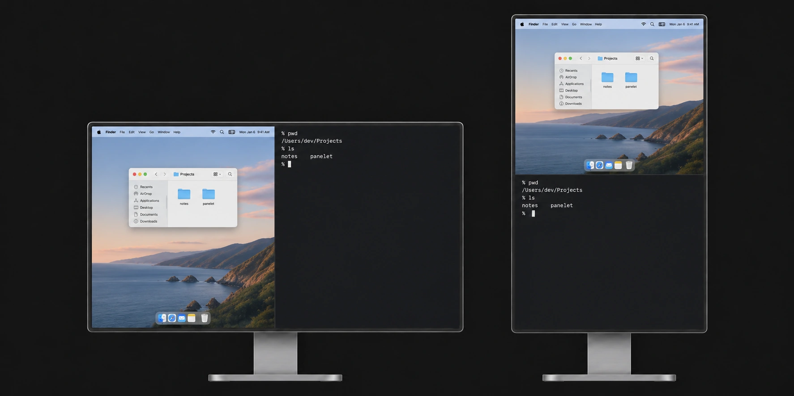

<p align="center">
  
</p>

<h1 align="center">Panelet</h1>

<p align="center">
  Panelet splits one physical monitor into two independent virtual displays, arranged side by side or stacked vertically.<br>
  Each display has its own menu bar, and macOS manages its desktops and native full-screen Spaces independently.
</p>

<p align="center">macOS 14 or later · <a href="LICENSE">AGPL-3.0-only</a></p>

<p align="center">
  <a href="#installation"><strong>Install from source</strong></a> ·
  <a href="#quick-start">Quick start</a> ·
  <a href="#troubleshooting">Get help</a> ·
  <a href="README.zh-CN.md">简体中文</a>
</p>

<p align="center">
  
</p>

## Why I built Panelet

I use two portrait monitors to read code. As I opened more projects, I found myself switching back and forth between editor windows. I wanted to split each monitor into a top and a bottom display so I could keep four projects in view across the two screens. macOS has no built-in way to do that, so I built Panelet.

## Installation

Build from source to try Panelet today. The first prebuilt installer is planned for [GitHub Releases](https://github.com/rankangkang/panelet/releases).

You'll need Xcode or Xcode Command Line Tools, Python 3, and a code-signing identity in your Keychain.

```sh
git clone https://github.com/rankangkang/panelet.git
cd panelet
./build.sh --install
```

The script installs and opens `/Applications/Panelet.app`. On first install it uses your Apple Development identity if there is exactly one available. To choose one for the first install, set `PANELET_SIGN_IDENTITY` to the certificate name or fingerprint.

To update, get the latest source, choose **Quit Panelet** from the menu bar, and follow the prompts to restore any active splits. Run `./build.sh --install` again. By default the script reuses the installed signing identity and verifies the new app against the installed app's signing requirements to preserve macOS permissions.

## Quick start

### First launch

1. In **System Settings → Desktop & Dock**, turn on **Displays have separate Spaces**. If you just changed it, log out and back in when macOS prompts you.
2. Open Panelet from **Applications** and follow **Getting Started** to grant **Screen Recording** and **Accessibility**. If Panelet is missing from either permissions list, use **+** to select `/Applications/Panelet.app`.
3. Choose **Restart and Continue** if prompted. Once permissions are ready, choose **Try a Split…** to test a layout or continue with **Finish Setup**. You can reopen **Getting Started…** from the menu bar.

### Split Desktop

From the Panelet menu bar icon, choose **Split Desktop** and select a display. Keep several windows in each desktop, drag windows between them, or run an app in macOS full screen in either region. The desktops stay split until you merge them.

### Window Pair

Press **⌃⇧S** (Control–Shift–S) to open the window picker. Choose a display and two windows, then press Return or click **Start Split**. Each window enters its own native full-screen Space. You can search, drag windows into place, swap them, and save combinations you use often.

The pair ends when either window leaves full screen or closes, or when either app quits. An existing desktop split on that display stays active.

### Layouts and shortcuts

Panelet can split several displays at once. Portrait displays split top to bottom by default, and landscape displays split side by side. Merge a display before changing its direction, ratio (1:1, 2:1, or 1:2), or rendering mode in **Settings… → Desktop Split**.

| Default shortcut | Action |
| --- | --- |
| **⌃⇧S** | Open the window picker |
| **⌃⇧J** | End the window pair or merge the split desktop under the pointer |
| **Esc** | Cancel a split while it is being prepared in the window picker |

Customize the two global shortcuts in **Settings… → Shortcuts** and set the interface language in **Settings… → General**.

## Permissions and compatibility

| macOS permission | How Panelet uses it |
| --- | --- |
| Screen Recording | Compose the split desktops and show window previews |
| Accessibility | Select, move, and restore windows and route the pointer across regions |

Panelet processes screen images on your Mac. Preferences and saved window pairs also stay local. Saved pairs keep app identifiers and matching window titles. You can preview diagnostics before copying or exporting them.

Panelet uses the private macOS interface `CGVirtualDisplay` to create virtual displays and ScreenCaptureKit to present their images on the physical display. macOS updates can change the behavior of virtual displays. Protected video and capture-restricted windows may appear black. Check HDR, wide color, and high refresh rates on your hardware.

## Troubleshooting

| If you see this | Try this |
| --- | --- |
| The split button is disabled | In **Settings… → Permissions**, check **Screen Recording**, **Accessibility**, and **Displays have separate Spaces**. |
| A split fails to start or the picture looks wrong | Choose **Check Environment…** from the menu bar to check whether the required macOS interfaces are available. |
| A display or window did not return to its previous position | Choose **Restore All Displays…** from the menu bar. If any windows still need recovery, choose **Retry Window Recovery…**. |

Panelet attempts to restore the display layout and window positions when a split ends. After an unexpected quit, it attempts recovery on the next launch if the display configuration matches.

For a bug report, include the Panelet version or build commit, macOS version, display setup, and steps to reproduce. Describe what you expected and what happened. You can attach a report from **Settings… → Diagnostics → Preview Report…**. [Report a bug or suggest a feature](https://github.com/rankangkang/panelet/issues)

## Contributing

Panelet is written in Swift with AppKit. Pull requests for bug fixes, documentation, and translations are welcome. Tell us what changed and how you verified it.

```sh
./tests/run.sh
./build.sh
```

The first command runs logic tests and localization checks. The second builds the app. You can also build the Panelet scheme in `Panelet.xcodeproj`. Keep App Sandbox disabled so Panelet can create virtual displays. For UI and permissions testing, update via `./build.sh --install` and open Panelet from **Applications**.

<details>
<summary>Display diagnostics and manual acceptance checks</summary>

List the detected displays, including orientation, scale, refresh rate, and position.

```sh
/Applications/Panelet.app/Contents/MacOS/Panelet --list
```

When changing split or recovery logic, check both split directions, exit full screen from either paired window, start and end a pair on an existing desktop split, and restore one display while others are split. Use test windows when checking recovery failures.

Manual acceptance notes are in Simplified Chinese.

- [Splitting, recovery, and diagnostics](tests/acceptance-2026-11-14.md)
- [First-time setup](tests/onboarding-acceptance-2026-11-14.md)
- [Two portrait displays and window pairs](tests/acceptance-2026-11-13.md)

</details>

## License

Panelet is licensed under the GNU Affero General Public License, version 3 only (`AGPL-3.0-only`). [License text](LICENSE)

The virtual-display interface declarations draw on Telas. [Telas](https://github.com/eduardoworrel/telas) · [Third-party notices](THIRD_PARTY_NOTICES) · [Panelet branding](branding/panelet/README.md)
