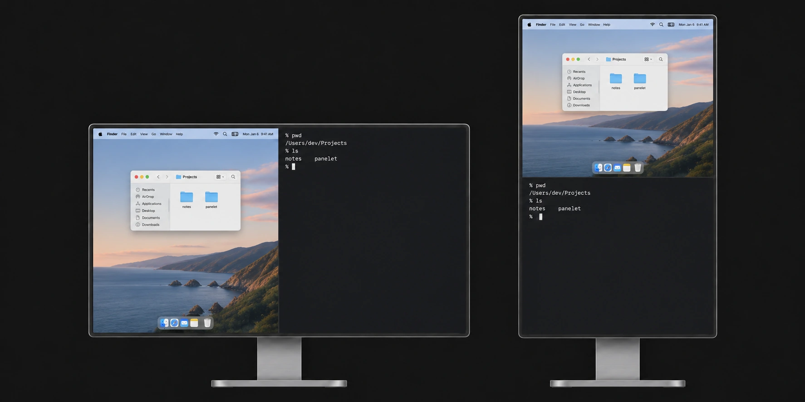

<p align="center">
  
</p>

<h1 align="center">Panelet</h1>

<p align="center">
  Panelet 将一块物理屏幕拆分为两个独立的虚拟显示器，支持左右或上下布局。<br>
  每个虚拟显示器都有自己的菜单栏，macOS 分别管理两者的桌面与原生全屏空间。
</p>

<p align="center">macOS 14 或更高版本 · <a href="LICENSE">AGPL-3.0-only</a></p>

<p align="center">
  <a href="#安装"><strong>从源码安装</strong></a> ·
  <a href="#快速上手">快速上手</a> ·
  <a href="#遇到问题">获取帮助</a> ·
  <a href="README.md">English</a>
</p>

<p align="center">
  
</p>

## 为什么做 Panelet

我平时用两块竖屏看代码。项目一多，就得来回切换编辑器窗口。我想，要是能把每块竖屏从中间分成上下两块，让 macOS 把它们当成独立的显示器，两块竖屏就能同时放下四个项目。macOS 没有内置这种拆法，于是我做了 Panelet。

## 安装

目前可以从源码安装 Panelet。首个预编译安装包计划发布在 [GitHub Releases](https://github.com/rankangkang/panelet/releases)。

构建需要 Xcode 或 Xcode Command Line Tools、Python 3，以及钥匙串中的代码签名身份。

```sh
git clone https://github.com/rankangkang/panelet.git
cd panelet
./build.sh --install
```

脚本会安装并打开 `/Applications/Panelet.app`。首次安装时，脚本会自动使用钥匙串里唯一有效的 Apple Development 签名身份，也可以通过 `PANELET_SIGN_IDENTITY` 指定证书名称或指纹。

更新时，先获取最新源码，再从菜单栏选择「退出 Panelet」。如有活动分屏，按提示恢复后退出，再运行 `./build.sh --install`。脚本默认沿用已安装版本的签名身份，并按原签名要求验证新版本，以便保留已有的 macOS 授权。

## 快速上手

### 首次打开

1. 在「系统设置 → 桌面与程序坞」开启「显示器使用不同的空间」。如果刚修改这项设置，请按 macOS 提示注销后重新登录。
2. 从「应用程序」打开 Panelet，按「使用导引」授予「屏幕录制」和「辅助功能」权限。如果权限列表里找不到 Panelet，点 **+** 选择 `/Applications/Panelet.app`。
3. 如果看到「重新启动并继续」，按提示操作。权限就绪后，可以点「试一次分屏…」试用布局，也可以直接点「完成设置」。以后可从菜单栏重新打开「使用导引…」。

### 拆分桌面

从菜单栏的 Panelet 图标选择「拆分桌面」，再选一块显示器。你可以在每个桌面放多个窗口、在两个桌面之间拖动窗口，也能让任一分区里的应用进入 macOS 原生全屏。拆分会一直保留，直到手动合并。

### 快捷窗口分屏

按 **⌃⇧S**（Control–Shift–S）打开选窗面板。选好显示器和两个窗口，按回车或点「开始分屏」，两个窗口会分别进入原生全屏空间。可以搜索、拖放和交换窗口，也可以收藏常用组合。

任一窗口退出全屏、关闭或所属应用退出时，组合会自动结束。如果这块显示器原先已经拆分，原有的桌面拆分会保留。

### 布局与快捷键

Panelet 可以同时拆分多块显示器。竖屏默认上下拆分，横屏默认左右拆分。要调整方向、比例（1:1、2:1 或 1:2）或画面模式，先合并对应显示器，再打开「设置… → 桌面分屏」。

| 默认快捷键 | 操作 |
| --- | --- |
| **⌃⇧S** | 打开选窗面板 |
| **⌃⇧J** | 结束鼠标所在的窗口组合，或合并鼠标所在的拆分桌面 |
| **Esc** | 在选窗面板中取消正在准备的分屏 |

在「设置… → 快捷键」可以修改两个全局快捷键，在「设置… → 通用」可以切换界面语言。

## 权限与兼容性

| macOS 权限 | 用途 |
| --- | --- |
| 屏幕录制 | 合成分区桌面画面，显示窗口预览 |
| 辅助功能 | 选取、移动和恢复窗口，处理跨分区的鼠标操作 |

屏幕画面在本机处理，偏好和收藏的窗口组合也只保存在本机。收藏包含应用标识和用于匹配的窗口标题。诊断报告可在复制或导出前预览。

Panelet 通过 macOS 私有接口 `CGVirtualDisplay` 创建虚拟显示器，再用 ScreenCaptureKit 把画面显示到物理屏上。系统更新可能改变虚拟显示器的行为。受保护视频和限制采集的窗口可能显示黑屏。HDR、广色域和高刷新率的效果请在实际设备上验证。

## 遇到问题

| 现象 | 处理方式 |
| --- | --- |
| 分屏按钮不可用 | 到「设置… → 权限」检查屏幕录制、辅助功能和「显示器使用不同的空间」。 |
| 分屏无法启动或画面异常 | 从菜单栏选择「检查运行环境…」，检查系统所需的接口是否可用。 |
| 显示器或窗口没有归位 | 从菜单栏选择「恢复所有显示器…」。如果仍有窗口未归位，选择「重试恢复窗口…」。 |

结束分屏时，Panelet 会尝试还原显示器排列和窗口位置。异常退出后，如果显示器配置匹配，Panelet 会在下次启动时尝试恢复。

提交问题时，请附上 Panelet 版本或构建所用的 Git 提交、macOS 版本、显示器配置和复现步骤，并说明预期和实际结果。也可以从「设置… → 诊断 → 预览诊断报告…」导出报告作为附件。[报告问题或提出建议](https://github.com/rankangkang/panelet/issues)

## 参与贡献

Panelet 使用 Swift 和 AppKit。欢迎通过 Pull Request 修复问题、改进文档或补充翻译。请说明改了什么，以及如何验证。

```sh
./tests/run.sh
./build.sh
```

第一条命令运行逻辑测试和本地化检查，第二条构建应用。也可以打开 `Panelet.xcodeproj`，选择 Panelet scheme 构建。工程保持 App Sandbox 关闭，以便创建虚拟显示器。需要验证界面或权限时，通过 `./build.sh --install` 更新，再从「应用程序」打开 Panelet。

<details>
<summary>显示器诊断与真机验收</summary>

以下命令列出检测到的显示器，以及它们的方向、缩放、刷新率和位置。

```sh
/Applications/Panelet.app/Contents/MacOS/Panelet --list
```

修改分屏或恢复逻辑时，请检查上下和左右布局、退出任一配对窗口的全屏、在已有拆分桌面上开始并结束窗口组合，以及多屏分屏时单独恢复一块屏。检查恢复失败的场景时请使用测试窗口。

- [分屏、恢复与诊断验收](tests/acceptance-2026-11-14.md)
- [首次使用导引验收](tests/onboarding-acceptance-2026-11-14.md)
- [双竖屏与快捷组合验收](tests/acceptance-2026-11-13.md)

</details>

## 许可证

Panelet 采用 GNU Affero General Public License 第 3 版（仅此版本，`AGPL-3.0-only`）。[许可证正文](LICENSE)

虚拟显示器的接口声明参考了 Telas。[Telas](https://github.com/eduardoworrel/telas) · [第三方许可与版权声明](THIRD_PARTY_NOTICES) · [Panelet 品牌素材](branding/panelet/README.md)
